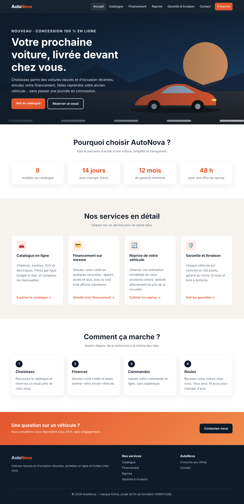
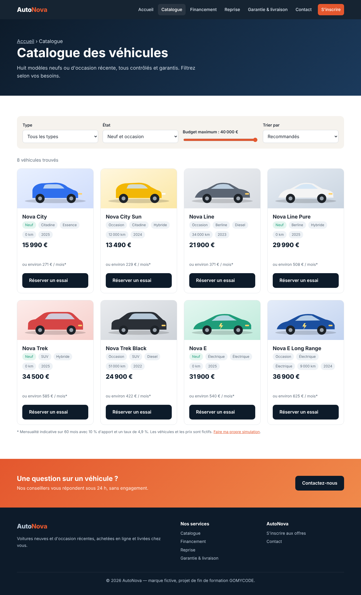
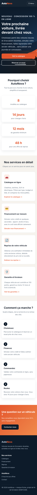

# 🚗 AutoNova — site de marketing pour la vente de voitures

Site de marketing d'**AutoNova**, une concession en ligne fictive de voitures neuves et d'occasion récentes, avec livraison à domicile. Le site présente le service et pousse les visiteurs à **s'inscrire** ou à **prendre contact**.

**🔗 Démo en ligne : https://adjaifouad40-spec.github.io/autonova/**

Projet de fin de formation (Lab Phase « Marketing Website ») — GOMYCODE, *Introduction au développement web avec compétences en IA*.

## 📄 Pages

| Page | Fichier | Contenu |
|---|---|---|
| Accueil | `index.html` | Grande image, présentation d'AutoNova, chiffres clés, cartes vers chaque page de fonctionnalité, étapes d'achat |
| Catalogue | `catalogue.html` | 8 véhicules, filtres par type, état et budget, tri, mensualité indicative, bouton « Réserver un essai » |
| Financement | `financement.html` | Simulateur de crédit (apport, durée, taux), coût total, tableau des formules |
| Reprise | `reprise.html` | Estimation de reprise selon la catégorie, l'année, le kilométrage et l'état, avec validation |
| Garantie & livraison | `garantie-livraison.html` | Contrôle en 120 points, tableau des garanties, étapes de livraison, FAQ |
| Inscription | `inscription.html` | Landing page avec offre de bienvenue et formulaire d'inscription validé en JavaScript |
| Contact | `contact.html` | Formulaire de contact validé et coordonnées |

## ✅ Les 3 phases du projet

1. **Squelette du site** : une page d'accueil avec photographie et vue d'ensemble, et des pages de fonctionnalités liées depuis l'accueil (Catalogue, Financement, Reprise, Garantie & livraison).
2. **Page d'inscription** : une landing page qui pousse à s'inscrire avec un formulaire (`inscription.html`).
3. **Composant Contact** : une page de contact avec formulaire. Un bandeau d'appel à l'action « Contactez-nous » figure **en bas de toutes les pages sauf la page Contact**.

## ✨ Fonctionnalités JavaScript
- Menu mobile (bouton ☰), et apparition des sections au défilement (`IntersectionObserver`)
- Catalogue généré à partir d'un tableau de données, avec filtres et tri en direct
- Filtres et formulaires pré-remplis par l'URL : `catalogue.html?type=suv`, `inscription.html?modele=Nova%20Trek`
- Simulateur de crédit : `mensualité = C × t / (1 − (1 + t)^−n)`
- Estimation de reprise avec décote selon l'âge, le kilométrage et l'état
- Validation des formulaires avec des règles déclarées dans le HTML (`data-rules="required email"`), messages sous chaque champ, puis confirmation

## 🚀 Lancer le projet
```bash
git clone https://github.com/adjaifouad40-spec/autonova.git
cd autonova
# ouvrir index.html dans le navigateur : aucune installation nécessaire
```

## 🗂️ Structure
```
index.html, catalogue.html, financement.html, reprise.html,
garantie-livraison.html, inscription.html, contact.html
css/style.css        styles communs (variables, grilles, responsive)
js/main.js           menu mobile, animations, format des prix
js/catalogue.js      données et filtres du catalogue
js/financement.js    simulateur de crédit
js/reprise.js        estimation de reprise
js/forms.js          validation des formulaires
images/              illustrations SVG
spec.md              spécifications détaillées
```

## 🔧 Technologies
HTML5 sémantique · CSS3 (variables, Flexbox, Grid, media queries) · JavaScript ES6 · GitHub Pages

## ♿ Accessibilité
Lien « Aller au contenu », `aria-current` sur la page active, `label` reliés à chaque champ, messages d'erreur sous les champs, focus visible, animations désactivées si `prefers-reduced-motion` est activé.

## ⚠️ À savoir
- AutoNova, ses véhicules, ses prix et ses coordonnées sont **fictifs**.
- Le site est statique : les formulaires sont validés puis affichent une confirmation, mais **aucune donnée n'est envoyée**.
- Les images sont des illustrations SVG. Pour mettre de vraies photos, remplacez les fichiers dans `images/`.

🔍 Voir les spécifications détaillées dans [spec.md](./spec.md).

## 📸 Captures
| Accueil | Catalogue | Mobile |
|---|---|---|
|  |  |  |

## 📄 Licence
MIT
